  

## Projets

| | Projet | Description |
|---|---|---|
| 🏝️ | [**Notchlet**](https://github.com/sami-krm/Notchlet) | Une « Dynamic Island » pour Mac : musique, batterie, HUD, calendrier, Bluetooth. *Swift · SwiftUI · AppKit* |
| 👕 | [**HabilleToi**](https://github.com/sami-krm/HabilleToi) | Ta tenue du jour composée avec ton dressing et la météo. *Expo · React Native · Supabase · Gemini* |
| 🔁 | [**WebLooping**](https://github.com/sami-krm/WebLooping) | Modélisation MCD / UML, MLD et génération SQL dans le navigateur. *HTML · CSS · JavaScript* |
| 🎣 | [**MasterBait**](https://github.com/sami-krm/MasterBait) | Jeu de pêche en 2D… attention à Cthulhu. *Python · Pygame* |
